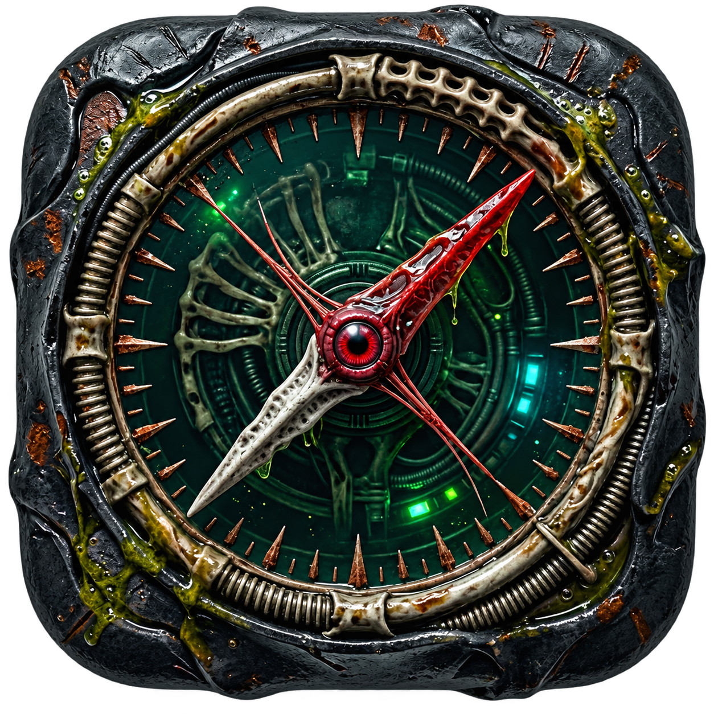
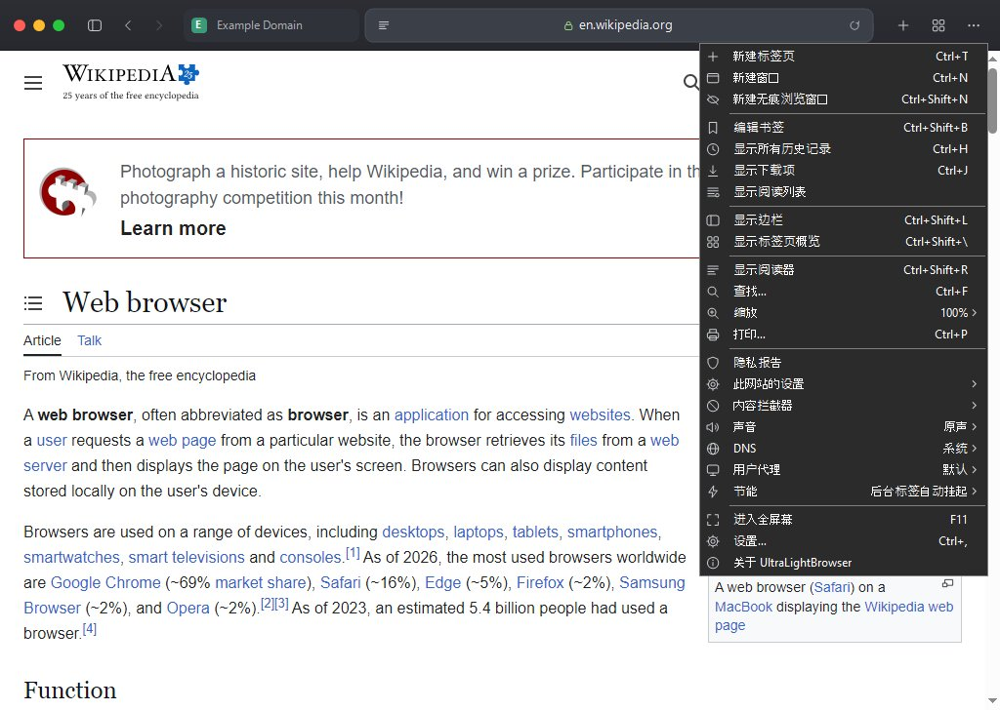

<p align="center">
  
</p>

<h1 align="center">UltraLightBrowser-Omarchy</h1>

<p align="center">
  专为 <strong>Omarchy / Arch Linux</strong> 打造的极简原生浏览器 · Rust + GTK4 + PipeWire + 系统 CEF + Go WARP/Xray
</p>

<p align="center">
  
  
  
  <a href="https://github.com/Freecode100Year/UltraLightBrowser"></a>
  <a href="LICENSE"></a>
</p>

<p align="center">
  
</p>

## 一键安装（Omarchy / Arch Linux）

在终端运行以下命令，自动安装系统依赖（`cef`、`gtk4`、`libpipewire`、`unzip` 等）、编译 Rust/Go 组件并打包为 Arch 系统包 `ultralightbrowser-git`（含应用启动器入口与图标）：

```bash
curl -fsSL https://raw.githubusercontent.com/Freecode100Year/UltraLightBrowser-Omarchy/main/install.sh | bash
```

- **默认兼容 `mise` / `rustup` / 系统 `pacman` 工具链**（本机已有 `cargo` 与 `go` 时不会重复安装）。
- **不打包 300MB+ 冗余内核**：动态链接 Arch 官方 `extra/cef`（`/usr/lib/cef/libcef.so`），随系统滚更获得安全更新。
- **启动**：终端执行 `ulb-linux`（无痕模式 `ulb-linux --private`），或直接从 Omarchy / Walker 应用启动器打开 **UltraLightBrowser**。
- **卸载**：
  ```bash
  sudo pacman -R ultralightbrowser-git
  ```

<details>
<summary>手动克隆与自定义安装选项</summary>

```bash
git clone https://github.com/Freecode100Year/UltraLightBrowser-Omarchy.git
cd UltraLightBrowser-Omarchy

# 方式 A：使用本地脚本（自动处理依赖与 mise/pacman 工具链）
bash install.sh

# 方式 B：标准 Arch PKGBUILD 打包安装（需通过 pacman 安装 rust 与 go）
cd linux/packaging && makepkg -si

# 方式 C：仅本地 Release 编译运行（不安装到系统目录）
go build -C warp -trimpath -o linux/target/release/ulb-warp .
cargo build --manifest-path linux/Cargo.toml --locked --release -p ulb-linux
./linux/target/release/ulb-linux
```

- 验证内核与 UA 标识自检：`ulb-linux --check`
- 环境变量覆盖：`ULB_WARP_BIN` 可指定自定义 `ulb-warp` 路径。

</details>

---

## 为什么选择 UltraLightBrowser-Omarchy

普通浏览器在 Linux 上往往带来这些问题：
- 全局代理/VPN 会接管整台机器流量；代理断开时普通浏览器静默回落直连，WebRTC 与系统 DNS 仍可能泄露真实 IP。
- 浏览器长期在 `~/.config` / `~/.cache` 残留历史、Cookie、缓存、下载记录。
- 网页套壳浏览器在 Wayland HiDPI 下内存与重绘开销高，无法融入原生 GTK4 / Hyprland 桌面。

**UltraLightBrowser-Omarchy** 将这些能力整合为一个原生 GTK4 + PipeWire 外壳与 Go 用户态隧道进程：
- **单浏览器独立加密线路**：默认开启 Cloudflare WARP，也可切换内置公益线路或自选订阅（VLESS / Trojan / VMess / Shadowsocks / Hysteria2），完全不改系统路由、不需 root 权限。
- **零痕迹 `tmpfs` 会话**：CEF `--user-data-dir` 仅创建在 `$XDG_RUNTIME_DIR/ulb-session-<pid>`（内存文件系统），退出自动清扫；异常强杀后下次启动按 PID 自动补删残留目录。
- **原生仿 macOS Safari 外壳**：`gtk4-rs` + Cairo/Pango 自绘单行紧凑标签栏即地址栏、线条图标、原生 `⋯` 菜单、阅读器、标签页概览、实时边栏与 Wayland 2x HiDPI 缩放支持。

---

## 核心特性

### 1. 网络与隐私隔离（`warp/` + `ulb-cef`）

浏览器提供三种网络模式，可在右上角 **「⋯ → 网络线路」** 或 **「设置 → 网络」** 中切换：

| 模式 | 出口 IP | 域名解析 | 断线行为 |
| :--- | :--- | :--- | :--- |
| **Cloudflare WARP**（默认） | Cloudflare 分配地址（每 3 天自动轮换 IPv6） | 隧道内 Cloudflare DNS | 默认可配置；勾选「WARP 断开时阻止联网」即**物理占口拒连**，绝不漏直连 |
| **我的线路**（公益线路 / 自选订阅） | 线路服务器出口 | 线路服务器远端解析 | **一律阻止联网**，从不直连 |
| **直接连接** | 本机真实 IP | 系统 DNS | — |

- **防泄露强制约束**：启动 CEF 时注入 `--proxy-server=socks5://127.0.0.1:<port>`、`--host-resolver-rules=MAP * ~NOTFOUND, EXCLUDE 127.0.0.1` 以及禁用非代理 UDP WebRTC 直连。
- **断线防抢占端口**：启用「阻止联网」或「我的线路」时，若 `ulb-warp` 意外退出，Rust 端立即绑定原 loopback 端口并拒绝连接，彻底防止流量漏出。
- **自选线路与订阅**：支持 `vless://`、`trojan://`、`vmess://`、`ss://`（含 2022）、`hysteria2://` / `hy2://`（支持 TCP / WS / HTTPUpgrade / XHTTP / gRPC、TLS / REALITY），支持测速与自动选优；拒绝 `allowInsecure` / `insecure=1` 链接。
- **本地加密保存**：线路与订阅使用 `ChaCha20-Poly1305` 加密保存在 `~/.local/share/ultralight/lines.dat`（密钥 `lines.key` 权限 `0600`）。

### 2. macOS Edge 浏览器标识（Linux 默认开启）

在保留系统 CEF 真实 Chromium 主版本号的前提下，统一改写多层指纹并在首请求发出前生效：

- **HTTP / JS UA**：`Mozilla/5.0 (Macintosh; Intel Mac OS X 10_15_7) ... Chrome/<ver> Safari/537.36 Edg/<ver>`
- **Client Hints（`Sec-CH-UA-*` / `navigator.userAgentData`）**：平台 `macOS`、版本 `27.2.0`（可在 `~/.config/ultralight/config.json` 的 `settings.macPlatformVersion` 调整）、架构 `arm`、64 位与真实 GREASE 品牌表。
- **WebGL / WebGPU / Worker / 滚动条**：会话级 M1/M2/M3/M4 GPU 与核心数画像、WebGPU `apple` · `metal-3`、Dedicated/Service Worker 同步改写、隐藏 SharedWorker、0px 悬浮滚动条。
- **内置自检页**：菜单 **「⋯ → 浏览器UA标识 → 检查当前浏览器UA标识…」**（`https://ulb.internal/selftest.html`）。

### 3. 广告拦截与阅读器

- **Rust 规则引擎（`rust/adblock`）**：拦截 230+ 广告与统计域名、第三方跟踪像素及 Service Worker 请求，自动将常见统计脚本替换为无害空壳，支持单站开关与 `Ctrl+Shift+H` 点选隐藏页面元素。
- **阅读器 & 原生面板**：基于 Mozilla Readability 的严格 CSP 阅读器、书签/文件夹与 Netscape HTML 导入导出、内存历史记录、标签页概览与边栏。

### 4. PipeWire 音频检测与 Web Audio DSP

- **PipeWire 热插拔检测**：通过 `libpipewire` 实时监听默认输出设备，自动区分耳机（含蓝牙 / USB DAC）与音箱/线路并动态切换耳机互馈（Crossfeed）。
- **可选浏览器音频增强**：支持原声直通或对白 / 轻柔 / 标准 / 影院四种模式、人声增强、齿音抑制、夜间防突响、单声道合并、最高 300% 音量放大与 `-1 dBTP` 真峰值限幅器。

### 5. Chrome 扩展程序与用户脚本

- 支持加载已解压扩展文件夹、`.crx` / `.zip` 扩展包，以及设置页内置推荐扩展（Global Speed、Proton VPN；CRX3 校验后经当前线路下载）。
- 扩展本体持久化在 `~/.local/share/ultralight/extensions/`，扩展运行期数据随 `tmpfs` 会话目录在退出时一并销毁。
- 内置用户脚本引擎，支持导入 `.user.js` 或普通 JS 及常用 `GM_*` API。

---

## 数据存储与零痕迹边界

| 位置 | 内容 | 生命周期 |
| :--- | :--- | :--- |
| `$XDG_RUNTIME_DIR/ulb-session-<pid>` | CEF 会话数据、Cookie 与缓存 | 仅本次运行（`tmpfs`），退出即删，启动时清理死 PID 目录 |
| `$XDG_RUNTIME_DIR/ulb.sock` | 单实例唤起与打开链接 Unix Socket | 随实例退出清理 |
| `~/.config/ultralight/config.json` | 浏览器偏好、UA 身份、元素隐藏规则 | 持久化 |
| `~/.local/share/ultralight/` | 书签、阅读列表、标签页组、加密 `lines.dat`、扩展安装包、用户脚本、WARP 账号缓存 | 持久化（不含浏览历史） |

---

## 快捷键

| 按键 | 功能 |
| :--- | :--- |
| `Ctrl+T` / `Ctrl+W` | 新建 / 关闭标签页 |
| `Ctrl+Shift+T` | 重新打开上次关闭的标签页 |
| `Ctrl+L` | 聚焦地址栏 |
| `Ctrl+F` | 页内查找 |
| `Ctrl+R` / `F5` | 刷新当前标签页 |
| `F11` | 进入 / 退出全屏 |
| `Esc` | 取消地址栏聚焦并关闭联想弹窗 |
| `Ctrl+N` / `Ctrl+Shift+N` | 新建窗口 / 无痕窗口菜单项（命令行可用 `--private`） |
| `Ctrl+D` / `Ctrl+Shift+D` | 添加书签 / 添加到阅读列表 |
| `Ctrl+Shift+B` / `Ctrl+H` | 书签 / 历史记录 |
| `Ctrl+Shift+L` / `Ctrl+Shift+\` | 边栏 / 标签页概览 |
| `Ctrl+Shift+R` | 阅读器 |
| `Ctrl+0` / `Ctrl++` / `Ctrl+-` | 实际大小 / 放大 / 缩小 |
| `Ctrl+,` | 打开设置 |

---

## 项目结构

```text
├── install.sh                 Omarchy / Arch Linux 一键 curl 安装脚本
├── linux/
│   ├── Cargo.toml             Linux Rust 工作区
│   ├── ulb-core/              纯 Rust 核心（配置、书签/历史、线路、用户脚本、扩展解包、UA/Stealth、Audio DSP、UI RPC 桥、WARP 托管）
│   ├── ulb-cef/               系统 extra/cef (156.x) FFI 绑定、OSR、代理隔离、自定义协议、Client Hints 覆盖
│   ├── ulb-linux/             GTK4 原生外壳、Cairo/Pango 标签栏、PipeWire 耳机监听、Wayland HiDPI、单实例控制
│   └── packaging/             Arch Linux PKGBUILD、.desktop 桌面入口、SVG 图标
├── warp/                      Go 用户态网络组件（Cloudflare WARP / WireGuard / Xray / 测速 / 订阅）
├── rust/adblock/              共享 Rust 广告与跟踪拦截引擎
├── ui/                        内置页面（起始页、设置、书签、历史、概览、边栏、阅读器）
├── server/                    自建轮换 IPv6 线路服务端脚本
├── tools/                     freedom8964.com 离线快照打包工具
├── src/ & android/            上游 Windows (WebView2) 与 Android 共享/同源实现
```

---

## 许可证与致谢

- 基于 [MIT 许可证](LICENSE) 开源；本项目同步自上游 [Freecode100Year/UltraLightBrowser](https://github.com/Freecode100Year/UltraLightBrowser)。
- 阅读器基于 [Mozilla Readability](https://github.com/mozilla/readability)（Apache-2.0，见 `ui/vendor/Readability-LICENSE.md`）。
- 网络组件（`warp/`）使用 [wireguard-go](https://git.zx2c4.com/wireguard-go)（MIT）、[gVisor](https://gvisor.dev)（Apache-2.0）和 [Xray-core](https://github.com/XTLS/Xray-core)（MPL-2.0）。
- Safari 为 Apple Inc. 商标，WARP 为 Cloudflare 服务，本项目与两者均无关联。
